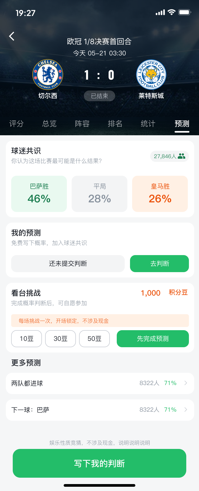
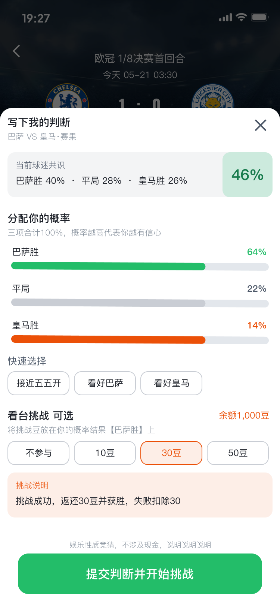
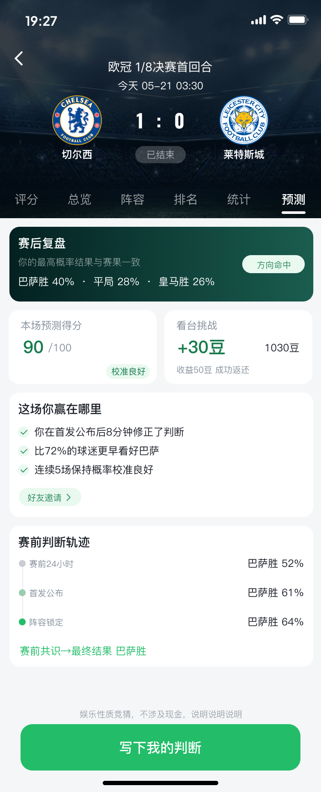

# 预测 Tab UI 规格（按蓝湖原型）

> **原型来源**：蓝湖项目「足球APP」→ 分组「预测」→ 球比赛详情-预测1/2/3。
> **画板**：375 × 922pt（预测2 为 375 × 812pt），设计稿 @1x；导出 PNG 为 @2x（750 宽）。
> **图片**：[赛前页](images/01-pre-match.png) · [判断面板](images/02-prediction-sheet.png) · [赛后复盘](images/03-post-match.png) · [三屏总览](images/00-lanhu-overview.png)
> **说明**：文中尺寸取自 Figma JSON 的 `text.frame` 与卡片 frame；圆角在 JSON 导入后全部丢失（值为 0），下表圆角为按截图目测的近似值。

## 1. 页面与状态映射

| 原型 | 页面 | 对应状态 | 关键内容 |
| --- | --- | --- | --- |
| 预测1 | 比赛详情-预测 Tab | 赛前、未提交 | 球迷共识 / 我的预测 / 看台挑战 / 更多预测 / 底部 CTA |
| 预测2 | 写下我的判断（底部弹层） | 赛前、填写中 | 概率滑杆 / 快捷选择 / 看台挑战档位 / 提交 |
| 预测3 | 比赛详情-预测 Tab | 赛后 | 赛后复盘 / 洞察分 / 看台豆 / 赢点 / 判断轨迹 |

**原型未覆盖**：已提交未开赛、进行中锁定、未参与赛后、比赛取消、无挑战的提交态、排行榜。这些状态需要补设计，不能从三屏直接推导。

## 2. 设计 Token

### 2.1 颜色

| Token | 值 | 用途 |
| --- | --- | --- |
| `brand-green` | `#23BD69` | 主按钮、选中态、进度条、正向数据 |
| `green-deep` | `#197C4E` | 深绿文字、赛后标题、得分 |
| `green-text` | `#338C62` | 参与人数、小标签文字 |
| `green-pale` | `#E9F9F0` | 浅绿底、标签底、选中底 |
| `orange` | `#EB5008` | 客胜、挑战豆、强调数字、选中描边 |
| `orange-pale` | `#FFF0E4` | 规则提示条、选中档位底 |
| `text-primary` | `#1D2129` | 主文字 |
| `text-secondary` | `#4E5969` | 次文字、说明 |
| `text-tertiary` | `#868B9C` | 辅助说明、占位、元信息 |
| `text-disabled` | `#C9CDD4` | 禁用、平局中性色 |
| `divider` | `#F3F4F5` | 分隔线、浅底块 |
| `page-bg` | `#F5F6F7` | 页面背景、浅灰卡片 |
| `card-bg` | `#FFFFFF` | 卡片 |
| `post-gradient` | `#032122 → #1B5D4F` | 赛后复盘头部卡（135°） |

### 2.2 字号与字重

字体：`PingFang SC`。行高约 130%。

| 级别 | 字号 | 字重 | 用途 |
| --- | --- | --- | --- |
| metric | 20 | 600 | 共识百分比、洞察分、+30豆 |
| cta | 16 | 600 | 主按钮 |
| title | 14 | 700 | 卡片标题、弹层标题、Tab |
| body | 12 | 400/500 | 正文、按钮小字、数据 |
| caption | 11 | 400 | 副标题、说明、元信息 |
| micro | 10 | 400/500 | 规则条、轨迹时间、页脚免责声明 |

### 2.3 间距、圆角、阴影

- 页面左右安全边距：`11pt`（卡片 x=11，宽 355）。
- 卡片内边距：左右 `16pt`、上 `10pt`、下 `16pt`；卡片间距：`10pt`。
- 主 CTA：`327 × 54pt`，x=24，圆角约 12。
- 卡片圆角约 12；小标签/档位圆角约 8；规则条约 4；弹层顶部圆角约 16。
- 页面背景 `#F5F6F7`，卡片无边框、无阴影（仅弹层有遮罩）。

## 3. 公共骨架

### 3.1 比赛头图

| 元素 | 位置/样式 |
| --- | --- |
| 容器 | 375 × 254，全宽，球队/球场图作背景，顶部深色渐变保证文字可读 |
| 返回 | 左上 22×22，白色，距顶约 54 |
| 赛事 | 居中，14/700 白，y≈69 |
| 时间 | 居中，12/400 白，y≈91 |
| 比分 | 居中，22/700 白，y≈126；冒号左右各留 8 |
| 队徽 | 左右各 48×48，距中轴约 84 |
| 队名 | 12/400 白，y≈171 |
| 状态 Pill | 居中，`已结束` 11/400 `#C9CDD4`，半透明黑底，圆角 999，高约 20 |

> 原型数据：切尔西 1:0 莱特斯城，`欧冠 1/8决赛首回合`，`今天 05-21 03:30`。但预测内容使用巴萨/皇马，属于占位数据混用；实现时必须由同一场比赛数据驱动。

### 3.2 栏目 Tab

- 6 等分：评分 / 总览 / 阵容 / 排名 / 统计 / 预测，字号 14。
- 未选中：白色 60%；选中：白色 700，底部 2pt 白色短横线（约 16 宽）。
- Tab 行位于 y≈222，头图底部；滚动时是否吸顶原型未定义。

### 3.3 底部操作区

- 页面底部固定：免责声明 `娱乐性质竞猜，不涉及现金，说明说明说明`（10/400 `#868B9C`，居中），主按钮 `写下我的判断`（16/600 白，`#23BD69`，327×54，圆角 12）。
- 内容区底部需预留「声明 + 按钮 + Home Indicator」高度，避免最后一张卡被遮挡。

## 4. 赛前页（预测1）

内容区从 y≈264 开始，卡片 x=11、w=355。

### 4.1 球迷共识卡（y=264，h≈144）

| 元素 | 规格 |
| --- | --- |
| 标题 | `球迷共识` 14/700 `#1D2129`，x=27，y≈274 |
| 参与人数 | 右上，`27,846人` 10/500 `#338C62` + 双人图标，浅灰 pill 底 |
| 副标题 | `你认为这场比赛最可能是什么结果？` 11/400 `#868B9C`，y≈295 |
| 三列结果 | 3 等分，间距 8，高约 64，圆角 8；上标签 12，下百分比 20/600，垂直居中 |
| 主胜 | 底 `#E9F9F0`，文字 `#197C4E`，`巴萨胜 46%` |
| 平局 | 底 `#F5F6F7`，文字 `#4E5969`，`平局 28%` |
| 客胜 | 底 `#FFF0E4`，文字 `#EB5008`，`皇马胜 26%` |

规则：百分比由后端聚合，前端只展示；必须同时展示参与人数，避免“无上下文百分比”。

### 4.2 我的预测卡（y=418，h≈103）

| 元素 | 规格 |
| --- | --- |
| 标题 | `我的预测` 14/700，y≈428 |
| 副标题 | `免费写下概率，加入球迷共识` 11/400 `#868B9C`，y≈449 |
| 左侧状态框 | 高 36，浅灰底 `#F5F6F7`，圆角 8，文字 `还未提交判断` 12/400 `#1D2129`，居中 |
| 右侧按钮 | `去判断` 12/500 白，`#23BD69`，高 36，圆角 8，约 72 宽 |
| 已提交态 | 原型未画：建议显示三个概率 + `已锁定` / `开赛前可修改 2 次`，点击进入修改 |

### 4.3 看台挑战卡（y=531，h≈131）

| 元素 | 规格 |
| --- | --- |
| 标题 | `看台挑战` 14/700，x=27，y≈541 |
| 余额 | 右上，`1,000` 14/600 `#EB5008` + `积分豆` 12/400 `#EB5008` |
| 副标题 | `完成概率判断后，可自愿参加` 11/400 `#868B9C`，y≈562 |
| 规则条 | 全宽减内边距，`#FFF0E4`，圆角 4，高约 22，文字 `每场挑战一次，开场锁定，不涉及现金` 10/400 `#EB5008`，居中 |
| 档位 | 3 个：`10豆 / 30豆 / 50豆`，每个约 62×32，白底、1pt `#E5E6EB` 边框、圆角 8，文字 12 |
| 右侧按钮 | `先完成预测` 12/500 白，`#23BD69`，约 118×32，圆角 8；未完成预测时为禁用/引导态 |
| 选中态 | 未画；参考弹层：`#FFF0E4` 底、`#EB5008` 1.5pt 描边、文字橙色 |

### 4.4 更多预测

| 元素 | 规格 |
| --- | --- |
| 分组标题 | `更多预测` 14/700，y≈672 |
| 行 | 白底，355×40，圆角 8，左右内边距 10，行间距 10 |
| 左 | 玩法名 12/400 `#1D2129`（`两队都进球`、`下一球：巴萨`） |
| 右 | `8322人` 11/400 `#868B9C` + `71%` 11/500 `#23BD69` + 右箭头 `#C9CDD4` |

> 具体玩法与数据口径原文未定义，属于原型占位；实现前需确认是否复用同一套预测/结算模型。

## 5. 判断弹层（预测2）

### 5.1 容器

- 全屏遮罩 `rgba(0,0,0,0.5)`；底部弹层从 y=144 到底部，高 668，顶部圆角 16，白底。
- 顶部无 grabber；标题 `写下我的判断` 14/700，x=10，y≈154；副标题 `巴萨 VS 皇马·赛果` 11/400 `#868B9C`，y≈175；右上关闭 24×24。
- 内容左右边距 10，区块间距 16。

### 5.2 当前球迷共识块

| 元素 | 规格 |
| --- | --- |
| 容器 | x=10，高约 68，浅灰底 `#F5F6F7`，圆角 8 |
| 标签 | `当前球迷共识` 11/400 `#4E5969`，x=21，y≈213 |
| 明细 | `巴萨胜 40% · 平局 28% · 皇马胜 26%` 12/400 `#1D2129`，y≈232 |
| 右侧大数 | 最高概率 `46%` 20/700 `#197C4E`，浅绿底块约 64×64，圆角 8 |

> 原型自身不一致：明细合计 94%，大数为 46%（与赛前页一致）。实现时以同一份聚合数据为准，三项必须合计 100%。

### 5.3 分配你的概率

| 元素 | 规格 |
| --- | --- |
| 标题 | `分配你的概率` 14/700，x=10，y≈282 |
| 说明 | `三项合计100%，概率越高代表你越有信心` 11/400 `#868B9C`，y≈303 |
| 行 | 三行：`巴萨胜` / `平局` / `皇马胜`，y≈327/376/425；左标签 12，右数值 12/600 |
| 滑杆 | 高 8，圆角 4，底 `#E5E6EB`；已填充：主胜 `#23BD69`、平局 `#C9CDD4`、客胜 `#EB5008` |
| 数值色 | 主胜 `#23BD69`、平局 `#4E5969`、客胜 `#EB5008` |

交互规则：

- 三项合计恒为 100%；拖动任一滑杆时其余两项按比例吸收差值，步进 1%。
- 数值允许 0–100，但建议限制单项 0–100、总和 100。
- 快捷选择：`接近五五开` / `看好巴萨` / `看好皇马`（13/400 `#4E5969`，chip 高 32，白底 1pt 边框，圆角 8）。具体预设值原型未标注【待确认】。

### 5.4 看台挑战

| 元素 | 规格 |
| --- | --- |
| 标题 | `看台挑战 可选`：主标题 14/700，`可选` 11/400 `#868B9C`，y≈545 |
| 余额 | 右上 `余额1,000豆` 12/500 `#EB5008` |
| 说明 | `将挑战豆放在你的概率结果【巴萨胜】上` 11/400 `#4E5969`，y≈566 |
| 档位 | 4 等分：`不参与 / 10豆 / 30豆 / 50豆`，高 32，间距 8，白底 1pt `#E5E6EB`，圆角 8 |
| 选中 | `30豆`：`#FFF0E4` 底、`#EB5008` 1.5pt 描边、文字 12/600 橙色 |
| 规则块 | `#FFF0E4`，圆角 8，内边距 10；标题 `挑战说明` 11/600 `#EB5008`；正文 12/400 `#1D2129`：`挑战成功，返还30豆并获胜，失败扣除30` |

规则：

- 挑战方向固定为概率最高的结果，不可另选；切换最高概率项时，说明中的【】与结算方向同步。
- 未选档位前，按钮文案可为 `提交判断`；选豆后为 `提交判断并开始挑战`。
- 余额不足时档位置灰，并提示差额；不允许负数。
- 每场只能挑战一次；确认后判断与挑战一起锁定。

### 5.5 底部

- 免责声明：`娱乐性质竞猜，不涉及现金，说明说明说明` 10/400 `#868B9C`，y≈719。
- 主按钮：`提交判断并开始挑战` 16/600 白，x=10，w=355，高 54，圆角 12，y≈738（贴安全区）。
- 未选择挑战时按钮文案建议 `提交判断`【待确认】。

## 6. 赛后复盘页（预测3）

内容区从 y≈264 开始。

### 6.1 赛后复盘头卡（y=264，h≈87）

- 深绿渐变（`#032122 → #1B5D4F`，135°），圆角 12，内边距 10。
- 标题 `赛后复盘` 14/700 白，y≈274。
- 副标题 `你的最高概率结果与赛果一致` 11/400 白（70%），y≈298。
- 右上标签 `方向命中` 10/500 `#338C62`，浅绿半透明底，圆角 999，约 40×18。
- 概率行 `巴萨胜 40% · 平局 28% · 皇马胜 26%` 12/400 白，y≈319。

> 未命中时应换成中性文案（如“你的最高概率结果与赛果不一致”），标签改为 `方向未命中`；颜色避免使用绿色成功语义。原型未画。

### 6.2 数据卡（y=361，h≈86，两列）

| 左：本场预测得分 | 右：看台挑战 |
| --- | --- |
| 标签 `本场预测得分` 12/400 `#868B9C` | 标签 `看台挑战` 12/400 `#868B9C` |
| `90` 20/700 `#197C4E` + `/100` 12/400 `#868B9C` | `+30豆` 20/700 `#197C4E` + `1030豆` 12/400 `#4E5969` |
| 标签 `校准良好` 10/500 `#197C4E`，浅绿底 pill | 说明 `收益50豆 成功返还` 10/400 `#868B9C` |

- 每列宽 173，间距 9，白底，圆角 12。
- 负收益时用 `#EB5008`，文案 `-50豆`，说明 `未命中 扣除50豆`；原型未画。
- 未参加挑战时，右侧显示 `未参与`，不显示豆数变化。

### 6.3 这场你赢在哪里（y=457，h≈145）

- 标题 14/700，y≈467。
- 三条洞察，12/400 `#1D2129`，行距 22，左侧 12×12 绿色对勾 `#23BD69`：
  - `你在首发公布后8分钟修正了判断`
  - `比72%的球迷更早看好巴萨`
  - `连续5场保持概率校准良好`
- 底部 chip `好友邀请 >` 10/500 `#338C62`，浅绿底，圆角 999，约 64×20。

> 三条文案由数据生成，原型为示例；需要定义生成规则与降级文案（无足够数据时隐藏该卡）。

### 6.4 赛前判断轨迹（y=612，h≈164）

- 标题 `赛前判断轨迹` 14/700，y≈622。
- 时间轴三行：`赛前24小时` / `首发公布` / `阵容锁定`，左侧 10/400 `#868B9C`，右侧 `巴萨胜 52% / 61% / 64%` 12/400 `#1D2129`。
- 圆点：8×8，依次 `#C9CDD4` / 浅绿 `#A8E6C3` / `#23BD69`；竖线 1pt `#E5E6EB`。
- 底部 `赛前共识→最终结果 巴萨胜` 12/400 `#23BD69`。

> 轨迹数据来源、采样时点、无历史时是否隐藏，原文未定义。

### 6.5 底部

- 原型仍显示 `写下我的判断`，与“已结束不再展示可操作按钮”的规则冲突。
- 实现建议：已结束隐藏主 CTA；改为 `分享复盘` 或 `查看我的预测`（需产品确认）。

## 7. 交互与状态

| 触发 | 行为 |
| --- | --- |
| 点击 `去判断` / 底部 CTA | 打开判断弹层；已有判断则带入当前值 |
| 拖动滑杆 | 实时更新三项数值与最高概率方向；总和恒 100 |
| 点击快捷 chip | 应用预设概率，可继续微调 |
| 选择挑战档位 | 校验余额；更新按钮文案与规则说明 |
| 点击关闭 / 遮罩 | 放弃编辑；若已有未提交修改，二次确认 |
| 提交（无挑战） | 校验 100% → 提交 → 关闭弹层 → 卡片显示已提交；开赛前可改，最多 3 次 |
| 提交（有挑战） | 校验 100% + 余额 → 扣豆并锁定 → 成功态；不可再改 |
| 开赛 | 全部入口锁定，展示“已锁定”；轮询/推送刷新比赛状态 |
| 比赛结束 | 切换为赛后复盘；刷新共识、得分、豆变化 |
| 取消/延期 | 返还挑战豆；页面展示“比赛取消，挑战豆已返还” |

异常与边界：

- 重复提交：按钮 loading + 幂等键，防止连点扣两次豆。
- 提交失败：保留弹层与用户输入，展示可重试提示。
- 余额变化：提交前二次校验；不足时提示当前余额。
- 网络失败：赛后数据可缓存上次结果，但必须标注更新时间。

## 8. 原型缺口（需补设计）

1. 已提交未开赛的「我的预测」卡（概率展示、修改入口、剩余次数）。
2. 进行中锁定态（顶部状态、卡片禁用样式、是否还能看共识）。
3. 未参加挑战的赛后数据卡。
4. 方向未命中的赛后头卡与颜色。
5. 比赛取消/延期的页面。
6. 排行榜入口与榜单页（原文只提方向）。
7. 更多预测的详情页/交互。
8. 空状态：无人参与、无历史轨迹、无洞察文案。
9. 分享复盘卡（图片/落地页）。
10. 规则说明页（承接“说明说明说明”）。

## 9. 验收要点

- 三种比赛状态与 Tab 内容一一对应，开赛后无任何可提交入口。
- 三项概率始终合计 100%，显示与提交值一致。
- 挑战方向始终等于最高概率项；扣豆、返豆、奖励与业务规则一致。
- 洞察分展示与后台使用同一整数，允许 ±0 误差。
- 赛后页在数据缺失时有降级文案，不出现 `undefined`/`NaN`。
- 所有占位文案（`说明说明说明`、示例球队）替换为真实数据。
