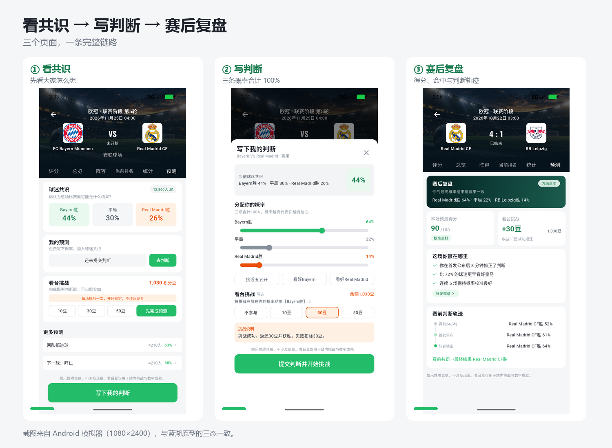
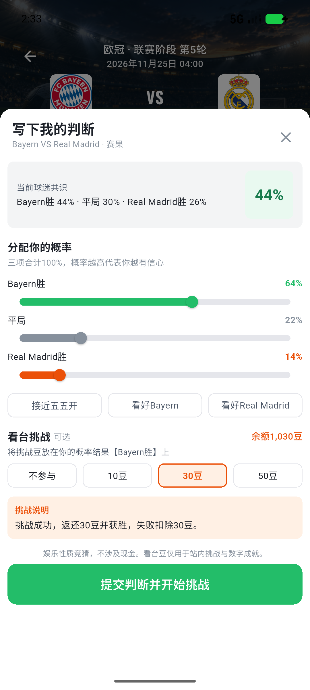
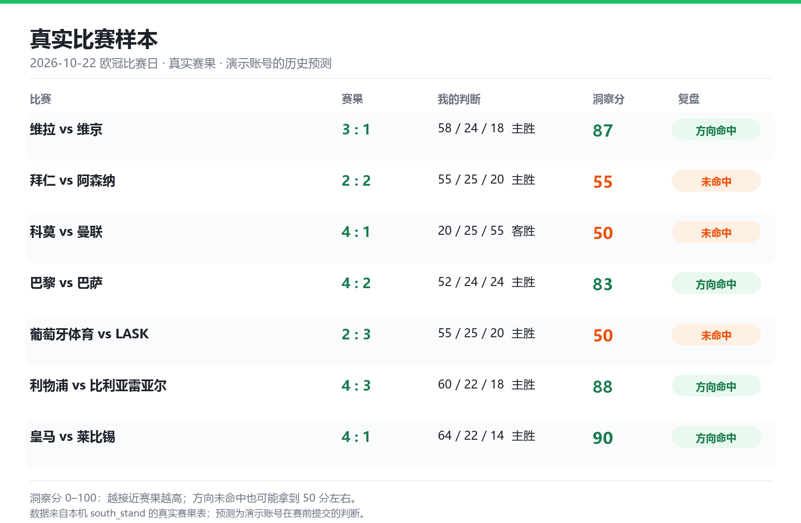
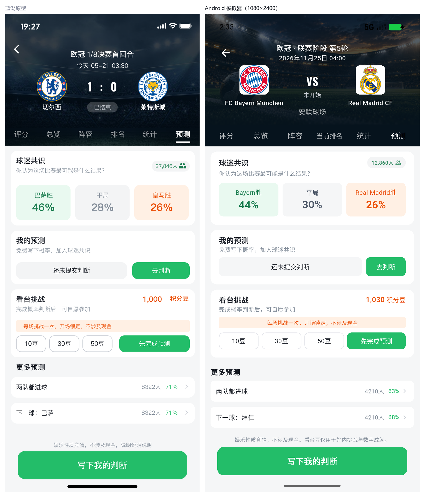

# 赛事预测功能汇报

**一句话：在比赛详情页新增「预测」Tab，让球迷赛前看共识、用概率写下判断，赛后自动复盘。**

汇报对象：老板
汇报日期：2026-11-16
当前版本：本机可演示版（Android 模拟器 + 本地后端）

> 这份汇报先用 Markdown 写，方便直接修改；确认后再导出 PDF。所有截图都来自本机真实运行的 App，不是设计稿。

## 1. 先看结论

- **用户侧**：给球迷一个“赛前表达判断”的轻互动。不是简单猜胜负，而是用三条概率表达“我有多确定”。
- **业务侧**：把比赛详情页从“看信息”变成“看信息 + 参与 + 赛后回来看结果”，增加赛前停留和赛后回访的理由。
- **产品侧**：不涉及现金充值、提现、用户间交易，也不做赔率、奖池、抽水；看台豆只做站内娱乐挑战和数字成就。
- **当前进度**：前后端、数据库、真实比赛数据、查询脚本和 Android 演示版都已跑通；页面三态与蓝湖原型保持一致。

## 2. 为什么值得做

一场比赛最热闹的时间，不只是开球后，还有开球前“大家怎么看”和终场后“谁看准了”。

过去比赛详情页主要承载比分、阵容、数据，用户看完就走。预测功能补上了三段空白：

1. **赛前有参与感**：不用写长评论，滑动三条概率就能表达观点。
2. **赛后有回访理由**：系统自动算分、复盘“你赢在哪里”，用户愿意回来看结果。
3. **内容有讨论度**：球迷共识、判断轨迹、好友邀请，都能成为分享和讨论的素材。

## 3. 用户怎么玩：三步完成一次预测

1. **看共识**：进入比赛详情的「预测」Tab，先看到当前球迷对主胜、平局、客胜的倾向，以及参与人数。
2. **写判断**：点「写下我的判断」，用三条滑杆分配概率，合计 100%；也可以点“接近五五开 / 看好主队 / 看好客队”快速选择。
3. **赛后复盘**：终场后同一入口自动变成「赛后复盘」，展示本场得分、方向是否命中、看台挑战结果和赛前判断轨迹。

## 4. 交互亮点：让“不会玩”的人也能一次上手

- **三条滑杆联动**：拖动任意一条，另外两条自动调整，始终合计 100%，不需要用户自己算。
- **快捷选项**：不想精细调整时，一键选择“接近五五开 / 看好主队 / 看好客队”。
- **挑战可选**：看台豆挑战默认“不参与”，用户自己选 10 / 30 / 50 豆；余额不足时不可选。
- **提交即锁定**：提交后按钮变灰，显示「已提交判断」，避免重复提交；比赛开始后入口锁定。
- **赛后即时反馈**：得分、命中标签、挑战返还、三条“你赢在哪里”和判断轨迹一次展示，用户不用理解公式。

## 5. 真实比赛数据：不是假数据，能对上赛果

本机数据库已加入 **7 场真实比赛** 的完整预测样本，全部来自已同步的真实赛果表。示例里既有命中，也有冷门：

- 皇马 4-1 莱比锡：判断 64 / 22 / 14 主胜，洞察分 **90**，方向命中，看台挑战 +30 豆。
- 利物浦 4-3 比利亚雷亚尔：判断 60 / 22 / 18 主胜，洞察分 **88**，方向命中。
- 维拉 3-1 维京：判断 58 / 24 / 18 主胜，洞察分 **87**，方向命中。
- 巴黎 4-2 巴萨：判断 52 / 24 / 24 主胜，洞察分 **83**，方向命中。
- 拜仁 2-2 阿森纳：判断主胜，实际平局，洞察分 **55**，方向未命中。
- 科莫 4-1 曼联：判断客胜，实际主胜，洞察分 **50**，冷门未命中。
- 葡萄牙体育 2-3 LASK：判断主胜，实际客胜，洞察分 **50**，未命中。

**说明**：未命中不代表 0 分。洞察分衡量的是“你的概率有多接近真实结果”，所以判断错但概率留了余地，仍可能拿到 50 分左右；这比“猜对/猜错”更耐玩，也更公平。

## 6. 和蓝湖原型对比：赛前页高度一致

左侧是蓝湖原型，右侧是本机 Android 模拟器实拍。以赛前页为例，卡片顺序、主按钮、核心文案和绿色主色都保持一致；判断面板和赛后复盘也用同一套设计 token 逐屏核对过。

有两处“有意不同”：

- 真实球队名更长，页面使用真实球队简称；原型里的“巴萨 / 皇马”是示意。
- 演示账号已有 1,030 豆，所以余额显示 1,030；新用户首次进入是 1,000 豆。

## 7. 规则与边界：老板最需要确认的四件事

1. **只做娱乐挑战**：不接现金充值、提现、用户间交易；不做赔率、奖池、抽水；不涉及现金、彩票和高价值实物奖励。
2. **单场一次**：每个用户每场只能提交一次判断；提交后不可修改；开赛后锁定。
3. **挑战可选**：10 / 30 / 50 豆三档，猜中返还本金并奖励，未命中扣除投入；比赛取消则原路退回。
4. **分数可解释**：0–100 分，越接近赛果越高；产品文案用“校准良好 / 方向命中 / 方向未命中”，不向用户暴露公式。

## 8. 现在完成到什么程度

**已经完成：**

- Android App 内可完整走通：看共识 → 写判断 → 提交 → 赛后复盘。
- 后端接口、6 张数据表、演示账号、看台豆钱包与流水。
- 7 场真实比赛样本，覆盖命中、未命中和冷门。
- 时间范围查询脚本，可按 1–2 个月（最长 6 个月）查询真实比赛与预测数据。
- 蓝湖原型、业务规则、UI 规格、实现说明和对比图都已归档。

**还需要完善：**

- 正式赛程的实时同步（当前是已结束比赛 + 一场演示用未开赛比赛）。
- 正式账号体系、风控、防刷和合规文案复核。
- 排行榜、好友邀请的完整体验。
- 更大样本的用户测试，确认滑杆手感和文案理解成本。

## 9. 建议的下一步

1. **先小范围灰度**：选 1–2 个联赛、1 个比赛日，观察有多少用户从“看比赛”走到“写判断”。
2. **看三个指标**：预测入口点击率、提交率、赛后复盘回访率；先验证参与，不急着看豆的输赢。
3. **补实时赛程**：让“未开赛 / 进行中 / 已结束”三态自动切换，运营不用手工配。
4. **再做社交裂变**：好友邀请、排行榜、判断轨迹分享，放在第二轮。

## 附：给技术同事的说明（老板可跳过）

- 客户端：Flutter，入口在比赛详情第 6 个 Tab「预测」，代码在 `apps/mobile/lib/features/prediction/`。
- 服务端：Spring Boot，接口 `GET/POST /api/app/football/matches/{matchId}/prediction`，代码在 `src/main/java/com/southstand/prediction/`。
- 数据表：`match_prediction`、`match_prediction_consensus`、`prediction_wallet`、`prediction_bean_log`、`prediction_trajectory`、`prediction_market`。
- 查询脚本：`py -3 scripts/prediction/query_prediction_data.py --from 2026-10-15 --to 2026-10-22`，最长支持 183 天。
- 演示账号：`prediction_demo / Prediction123!`；演示比赛：`575370`（赛后）、`700001`（赛前）。
- 详细材料：`docs/references/win-prediction/01-business-rules.md`、`02-ui-spec.md`、`04-implementation.md`。
